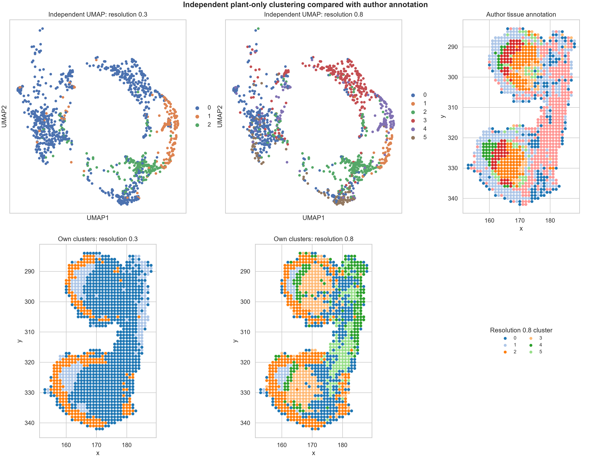

# Medicago 根瘤空间转录组复现

[](https://github.com/sailan-huang/medicago-spatial-reproduction/actions/workflows/ci.yml)

基于 Shao et al., *Cell* (2026) 的公开数据，对一个 P3 苜蓿根瘤 Stereo-seq 切片进行
可重复的局部重分析。目标是展示空间转录组从**表达矩阵**到**组织解释**的完整计算链条，
而不是重跑原始 FASTQ 或论文中的湿实验。

[论文 DOI](https://doi.org/10.1016/j.cell.2026.07.033) ·
[公开数据](https://db.cngb.org/stomics/stamrn/download/) ·
[作者代码](https://github.com/XiangSH111/Legume_Spatial_Atlas) ·
[完整复现报告](docs/analysis_report.md) ·
[Notebook HTML 预览](docs/reproduction_notebook.html)

## 已完成内容

- 读取并校验 `FP200000569BR_C5_bottom4_MXP3.h5ad`：1,284 个空间 bin、40,160 个基因。
- 重建每个 bin 的总计数、检测基因数、植物计数、根瘤菌计数和根瘤菌占比。
- 仅使用植物基因独立完成 HVG、PCA、邻居图、UMAP 和两档 Leiden 聚类。
- 从论文 Table S1-5 和 Mt5.0 官方注释解析区域标记，输出点图和空间图。
- 比较独立聚类与作者组织分区，并保留未通过“完全一致”标准的真实指标。
- 输出 7 张核心图、7 张派生表、可执行 Notebook、报告和输入契约测试。

## 主要结果

| 项目 | 结果 |
|---|---|
| 样本 | P3，`FP200000569BR_C5_bottom4_MXP3` |
| 空间 bin | 1,284 |
| 植物 / 根瘤菌基因 | 34,349 / 5,811 |
| 独立分辨率 0.8 | 6 个簇，ARI 0.199、NMI 0.300（对照作者区域） |
| 标记验证 | 9 个可检测标记，其中 4 个的最高区域与 Table S1-5 预期一致 |
| 根瘤菌占比 | 感染区和交界区较高，固氮区低于感染区 |

这些结果说明公开数据可以支持单切片级的分析和解释，但单切片不能重现论文的完整跨阶段图谱。



## 快速运行

Windows PowerShell：

```powershell
cd D:\课堂\cds
.\run.ps1
```

首次运行会创建 `.venv`、下载公开数据、检查 SHA-256、执行测试，并从零运行 Notebook。

手动运行：

```powershell
uv venv .venv --python 3.12
uv pip install -r requirements.txt
.\.venv\Scripts\python.exe scripts\download_data.py
.\.venv\Scripts\python.exe -m pytest -q
.\.venv\Scripts\python.exe -c "from analysis.reproduction import run_analysis; run_analysis()"
.\.venv\Scripts\python.exe scripts\build_report.py
```

## 仓库结构

```text
analysis/                 可复用分析函数
config/analysis.yaml      参数、数据 URL 与 SHA-256
data/                     公开数据说明；原始文件不入 Git
notebooks/                 Notebook 源码与执行后的 .ipynb
results/figures/           核心结果图
results/tables/            bin 级结果、聚类指标、标记与区域汇总量
scripts/                  下载与报告生成脚本
tests/                    输入契约和数据守恒测试
docs/analysis_report.md   完整方法、结果、对照与局限
```

## 复现边界

本仓库复现的是**单样本局部计算**。原始测序处理、完整 20 个切片整合、RNA velocity、
Monocle 3、WGCNA，以及论文中的 CRISPR、RNAi、ROS、EMSA、双荧光素酶和固氮表型实验
均不在范围内。

数据与第三方注释不随仓库分发，遵循各自上游条款。仓库代码采用 MIT License。

