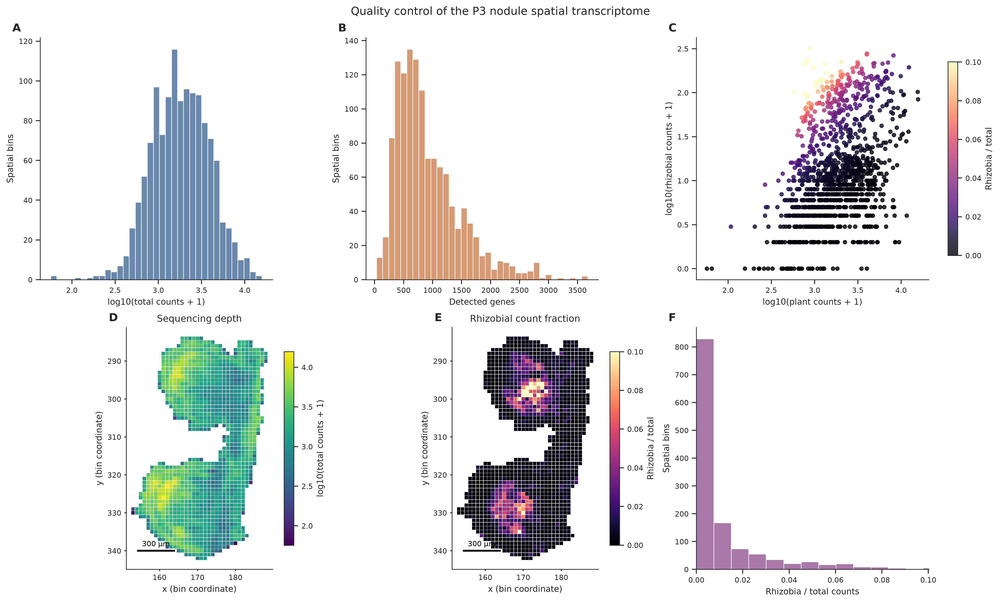
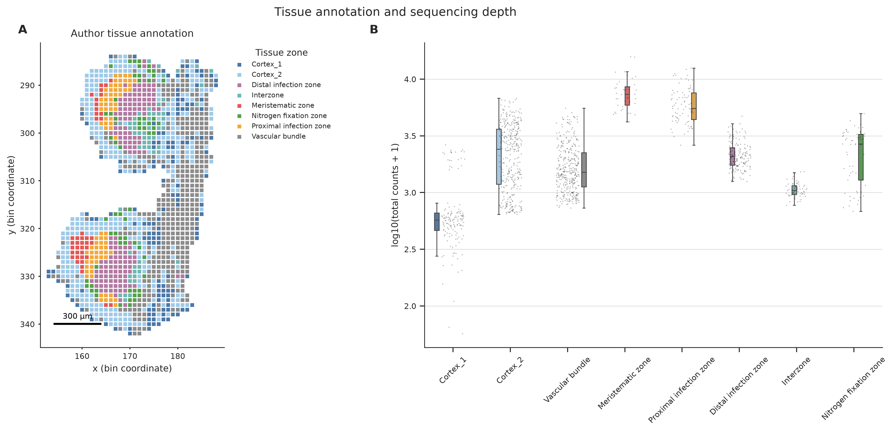
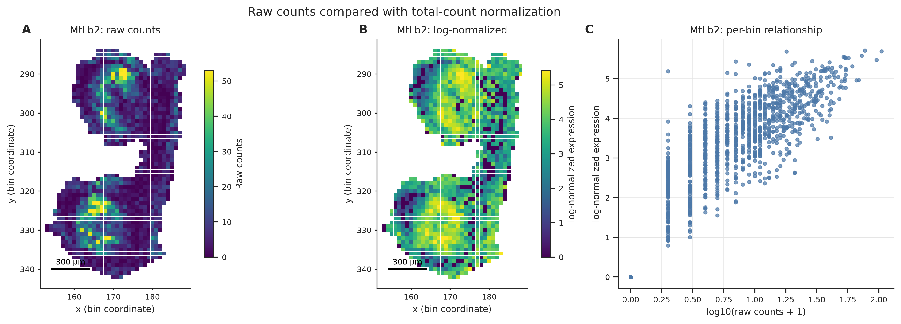
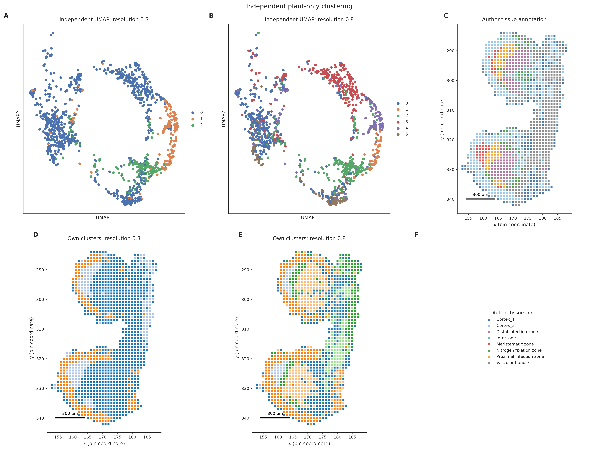
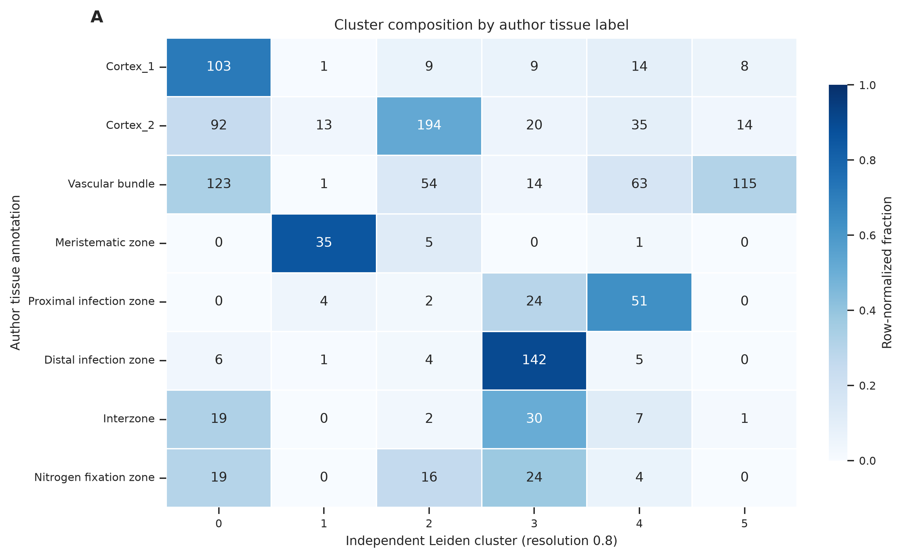
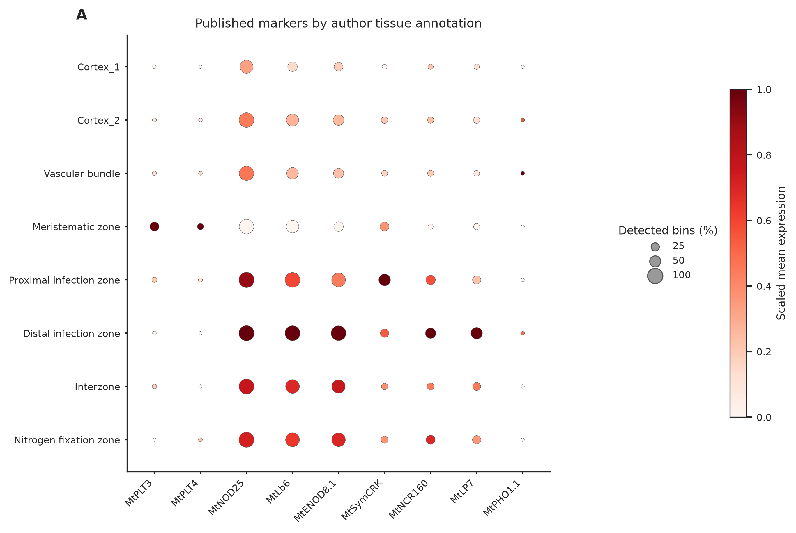
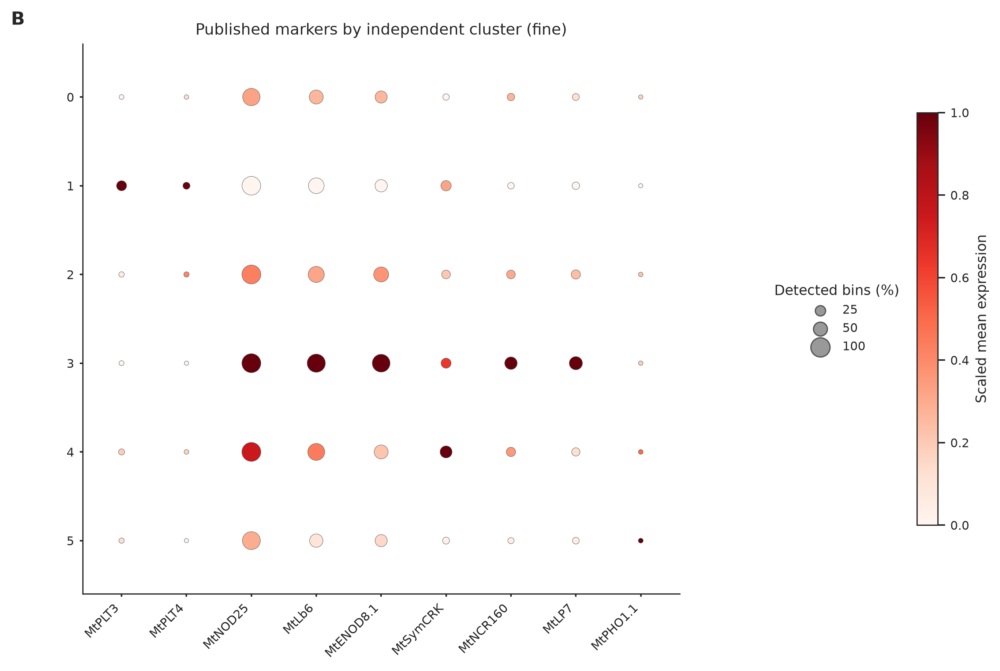
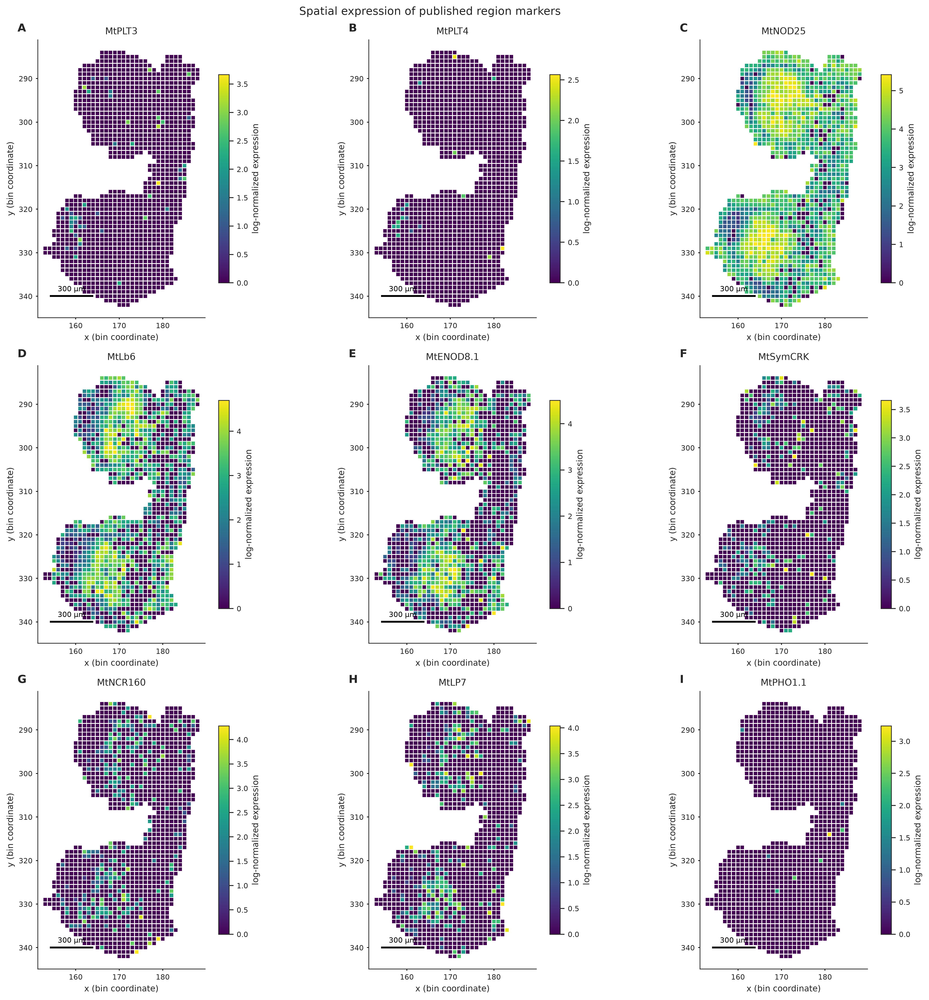
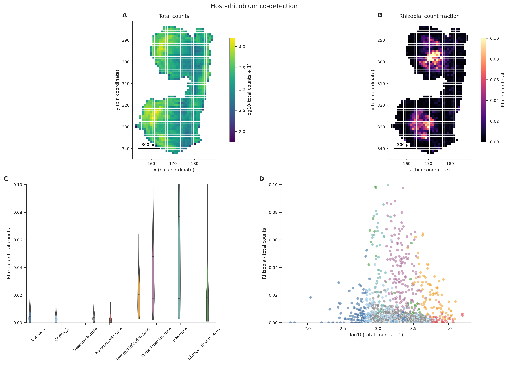

# 苜蓿根瘤空间转录组复现报告

## 复现对象

本工作复现 Shao et al., *Cell* (2026) 论文中的一个代表样本：
`FP200000569BR_C5_bottom4_MXP3.h5ad`（P3，14 dpi）。论文完整研究包含 5 个发育阶段、
20 个切片和 20,841 个细胞/空间单元；本仓库不声称重建完整图谱。

复现范围包括：

1. 从公开计数矩阵重建质量指标，检查植物与根瘤菌计数；
2. 仅使用植物基因独立完成高变基因选择、PCA、邻居图、UMAP 与 Leiden 聚类；
3. 根据论文补充表与 Mt5.0 官方注释解析标记基因，并绘制分组和空间表达；
4. 计算每个空间 bin 的根瘤菌计数占比，比较作者组织分区。

原始 FASTQ 过滤、STAR 比对、完整多切片 Harmony 整合、RNA velocity、
Monocle 3、WGCNA、CRISPR/RNAi、ROS 染色及固氮表型实验均不在本次范围内。

## 数据完整性与可重复性

- 空间 bin：**1,284**
- 基因：**40,160**，其中植物 **34,349**、根瘤菌 **5,811**
- 非零计数：**1,179,814**
- 总计数：**3,088,044**
- 原始计数层与 `.X` 一致：**True**
- 原始计数为非负整数：**通过**
- `nCount_Spatial`、`nFeature_Spatial` 与重算值一致：**通过**
- 坐标与 `array_row/array_col` 一致：**通过**
- 基因 ID 唯一、坐标有限、组织标签无缺失：**通过**
- 植物分析保留 bin：**1,284**
- 植物分析保留基因：**19,515**

单个 bin 的总计数中位数为 **1789.5**（范围 56–15810），
检测基因数中位数为 **770.0**。随机种子固定为
`42`，所有主要参数记录在
[`config/analysis.yaml`](../config/analysis.yaml) 和
[`run_metadata.json`](../results/tables/run_metadata.json)。
全部图均输出 300 dpi PNG 和可缩放 PDF/SVG。

论文补充表 S1-3 对同一样本报告 **1,270** 个 cell/bin，
而公开 `.h5ad` 包含 **1,284** 个 bin。本复现保留公开对象中的全部
1,284 个 bin，不做无法从文件中唯一确定的删除；该 14-bin 差异被视为
上游处理或版本差异，并记录在 `run_metadata.json`。

## 结果

### 1. 质量检查与标准化

图 1. P3 切片质量检查。**(A)** 每个 bin 的总计数；**(B)** 检测基因数；
**(C)** 植物与根瘤菌计数关系；**(D)** 测序深度空间分布；**(E)** 根瘤菌计数占比；
**(F)** 根瘤菌占比分布。空间图比例尺为 300 µm。

测序深度和组织边界需要同时检查。根瘤菌占比不能被直接解释为细菌数量：
低深度 bin 的比例方差更大，而且植物与细菌 RNA 的捕获效率不同。

图 2. 作者组织注释和测序深度。颜色在所有空间图中保持一致。

图 3. 同一基因 `MtLb2` 的原始计数、标准化表达和逐 bin 关系。该图验证计数标准化
改善跨 bin 可比性，同时保留主要空间轮廓。

### 2. 独立聚类

仅使用植物原始计数，过滤后以 10,000 counts/bin 标准化并执行 `log1p`。使用 2,000 个高变基因、
20 个主成分、15 个邻居，比较 Leiden 分辨率 0.3 与 0.8。

图 4. 植物表达独立聚类。**(A–B)** 两档分辨率的 UMAP；**(C–E)** 作者标签与独立聚类的空间对照；
**(F)** 作者组织颜色图例。空间图比例尺为 300 µm。

| 指标 | 分辨率 0.3 | 分辨率 0.8 |
|---|---:|---:|
| 聚类数 | 3 | 6 |
| ARI vs 作者区域 | 0.057 | 0.199 |
| NMI vs 作者区域 | 0.190 | 0.300 |
| PCA-20 silhouette | 0.069 | 0.068 |
| 空间 6-近邻同类比例 | 0.784 | 0.579 |

独立聚类保留了明显的空间分区，但没有复制作者标签。ARI 为 **0.199**、
NMI 为 **0.300**，说明单切片表达聚类与整合了更多样本和人工证据的区域注释
只部分一致。作者标签自身的空间 6-近邻同类比例为
**0.543**；两档独立聚类均不低于该值，
说明结果具有空间连续性。这里没有为了追求与原文相似而继续挑选分辨率。

图 5. 作者区域与独立聚类的混淆矩阵。格内数字为 bin 数，颜色为按作者区域行归一化后的比例。

### 3. 标记基因

标记候选来自论文补充表 Table S1-5，并通过 Mt5.0 官方注释表解析到数据中的 locus ID。
共解析 **9** 个可检测标记，其中 **4** 个在本 P3 切片中
的最高平均表达区域与其在完整论文图谱中的预期区域一致。

图 6–8. 论文 Table S1-5 标记在作者区域和独立聚类中的表达，以及逐基因空间分布。
标记的 locus ID 同时通过 Mt5.0 官方注释核对；比例尺为 300 µm。

| 标记 | 预期区域 | 本切片最高区域 | 区域一致 | 总体检出率 | Table S1-5 证据 |
| --- | --- | --- | --- | --- | --- |
| MtPLT3 | Meristematic zone | Meristematic zone | True | 0.036 | True |
| MtPLT4 | Meristematic zone | Meristematic zone | True | 0.013 | True |
| MtNOD25 | Proximal infection zone | Distal infection zone | False | 0.917 | True |
| MtLb6 | Proximal infection zone | Distal infection zone | False | 0.667 | True |
| MtENOD8.1 | Distal infection zone | Distal infection zone | True | 0.538 | True |
| MtSymCRK | Interzone | Proximal infection zone | False | 0.174 | True |
| MtNCR160 | Nitrogen fixation zone | Distal infection zone | False | 0.185 | True |
| MtLP7 | Nitrogen fixation zone | Distal infection zone | False | 0.192 | True |
| MtPHO1.1 | Vascular bundle | Vascular bundle | True | 0.006 | True |

分生区中 `MtPLT3` 和 `MtPLT4`、感染区中 `MtNOD25`、`MtLb6` 和 `MtENOD8.1`
具有清晰表达和空间聚集。`MtSymCRK`、`MtNCR160` 与 `MtLP7` 也呈现区域相关信号，
但本次单切片的最高区域与完整图谱命名并不完全一致。可能原因包括：单个 P3 切片的采样位置、
相邻区域标签边界、跨阶段注释证据，以及基因家族/同源基因命名差异。

从作者标签内部重新计算的每个区域前三个差异基因如下：

| 区域 | locus ID | 符号 | Wilcoxon 分数 | log2FC | 校正 p 值 |
| --- | --- | --- | --- | --- | --- |
| Cortex_1 | MtrunA17Chr5g0421871 | nan | 3.005 | 0.054 | 0.080 |
| Cortex_1 | MtrunA17Chr5g0422111 | nan | 1.949 | -0.082 | 0.671 |
| Cortex_1 | MtrunA17Chr5g0422321 | nan | 1.890 | -0.255 | 0.740 |
| Vascular bundle | MtrunA17Chr8g0360121 | nan | 9.734 | 2.309 | 0.000 |
| Vascular bundle | MtrunA17Chr7g0238571 | nan | 8.315 | 1.983 | 0.000 |
| Vascular bundle | MtrunA17Chr1g0200301 | nan | 7.526 | 1.273 | 0.000 |
| Cortex_2 | MtrunA17Chr2g0281901 | nan | 9.623 | 1.463 | 0.000 |
| Cortex_2 | MtrunA17Chr2g0306461 | MtPCY30 | 8.846 | 1.692 | 0.000 |
| Cortex_2 | MtrunA17Chr4g0056391 | MtnsLTP82 | 8.638 | 2.153 | 0.000 |
| Meristematic zone | MtrunA17Chr1g0210791 | nan | 8.174 | 3.493 | 0.000 |
| Meristematic zone | MtrunA17Chr8g0339111 | nan | 7.779 | 3.180 | 0.000 |
| Meristematic zone | MtrunA17Chr8g0335461 | nan | 7.651 | 3.313 | 0.000 |
| Proximal infection zone | MtrunA17Chr3g0100421 | nan | 13.157 | 2.455 | 0.000 |
| Proximal infection zone | MtrunA17Chr2g0300911 | MtNodGRP2A | 11.170 | 3.717 | 0.000 |
| Proximal infection zone | MtrunA17Chr2g0300901 | MtNodGRP11 | 11.099 | 3.165 | 0.000 |
| Nitrogen fixation zone | MtrunA17Chr7g0224291 | MtNCR158 | 6.102 | 1.804 | 0.000 |
| Nitrogen fixation zone | MtrunA17Chr5g0427351 | MtLb2|MtLb6|MtLb1 | 5.643 | 1.275 | 0.000 |
| Nitrogen fixation zone | MtrunA17Chr1g0148751 | MtLb4|MtLb1|MtLb2 | 5.322 | 1.486 | 0.001 |
| Distal infection zone | MtrunA17Chr2g0311901 | MtNodGRP3C | 17.599 | 3.494 | 0.000 |
| Distal infection zone | MtrunA17Chr7g0224291 | MtNCR158 | 17.086 | 3.208 | 0.000 |
| Distal infection zone | MtrunA17Chr3g0100391 | MtNOD25|MtN22 | 16.569 | 2.274 | 0.000 |
| Interzone | MtrunA17Chr2g0311901 | MtNodGRP3C | 7.079 | 2.218 | 0.000 |
| Interzone | MtrunA17Chr7g0224291 | MtNCR158 | 6.823 | 2.002 | 0.000 |
| Interzone | MtrunA17Chr5g0427351 | MtLb2|MtLb6|MtLb1 | 6.141 | 1.571 | 0.000 |

这一结果用于说明后续区域发现流程，而不是独立验证实验功能。

### 4. 植物–根瘤菌共检测

| 区域 | bin 数 | 中位占比 | Q1 | Q3 | 中位总计数 |
| --- | --- | --- | --- | --- | --- |
| Cortex_1 | 144 | 0.005 | 0.002 | 0.009 | 571.500 |
| Cortex_2 | 368 | 0.003 | 0.001 | 0.005 | 2414.500 |
| Distal infection zone | 158 | 0.032 | 0.017 | 0.048 | 2078.500 |
| Interzone | 59 | 0.046 | 0.018 | 0.077 | 1043.000 |
| Meristematic zone | 41 | 0.002 | 0.001 | 0.004 | 7353.000 |
| Nitrogen fixation zone | 63 | 0.007 | 0.004 | 0.018 | 2685.000 |
| Proximal infection zone | 81 | 0.020 | 0.010 | 0.029 | 5530.000 |
| Vascular bundle | 370 | 0.004 | 0.002 | 0.007 | 1507.500 |

图 9. 根瘤菌计数占比的空间分布、深度依赖和组织区域比较。纵轴在 99% 分位处截断显示。

统计检验仅作描述性辅助：

| 检验 | 比较 | n₁ | n₂ | 统计量 | p 值 | 解释边界 |
| --- | --- | --- | --- | --- | --- | --- |
| Mann-Whitney U | Nitrogen fixation zone vs all other regions | 63 | 1221 | 48309.500 | 0.000601 | descriptive; spatial bins are not independent biological replicates |
| Kruskal-Wallis | all author tissue regions | 8 | 1284 | 554.483 | 1.53e-115 | descriptive; spatial bins are not independent biological replicates |

本切片中根瘤菌占比最高的区域中位数为：

| organ | median_rhizobia_fraction | n_bins |
| --- | --- | --- |
| Interzone | 0.046 | 59 |
| Distal infection zone | 0.032 | 158 |
| Proximal infection zone | 0.020 | 81 |

固氮区在本切片中的根瘤菌计数占比中位数为 **0.0069**，低于感染区和交界区。
这并不否定论文跨阶段图谱中成熟固氮区富含根瘤菌的结论，而是说明单切片、单阶段和
相对计数指标不足以重现跨阶段空间趋势。计数占比同时受总深度和 RNA 组成影响，
不能作为细菌量、单菌表达或固氮效率的直接测量。

## 与论文和作者代码的关系

- 论文分析了 20 个切片并整合 20,841 个空间单元；本复现只使用一个 P3 切片。
- 作者 GitHub 提供 Giotto、Harmony、Monocle3、WGCNA、RNA velocity 等分析脚本，
  但脚本依赖未公开的 CSV/RDS 路径，不是开箱即用流程。
- 本仓库补充了数据下载、SHA-256 校验、输入契约测试、端到端 Python 流程、
  固定参数、可执行 Notebook 和派生结果。
- 本复现属于“图级局部重分析”，不是原始数据全流程复现或实验验证复现。

## 局限性

1. 公开 `.h5ad` 已经过作者处理，不能追问其原始过滤、比对和 bin 生成步骤。
2. 单切片不包含完整 P1–P5 发育轨迹，也不含本切片中的衰老区。
3. 作者空间标签用于结果对照和描述性差异分析，不能被当作独立金标准。
4. 聚类与作者注释的一致性为中等偏低；UMAP 方向与 Leiden 编号没有生物学含义。
5. 根瘤菌占比是相对捕获计数，不是绝对细菌负荷。
6. 所有区域差异均为观察性关联，需要独立切片、真实实验和功能验证。

## 结论

该复现证明：公开数据足以支持单样本级空间矩阵核验、植物表达聚类、官方标记映射与
宿主–根瘤菌相对信号分析；结果大体支持组织分区与共生相关表达的空间结构化，
但单切片分析不能替代论文的跨阶段整合和实验验证。
